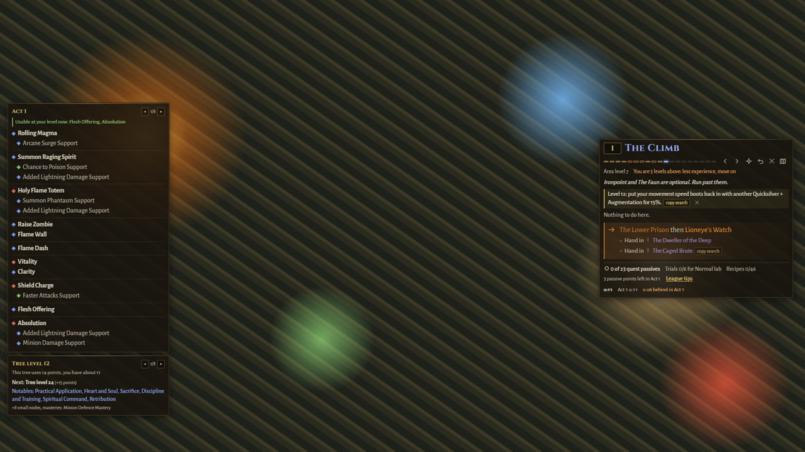
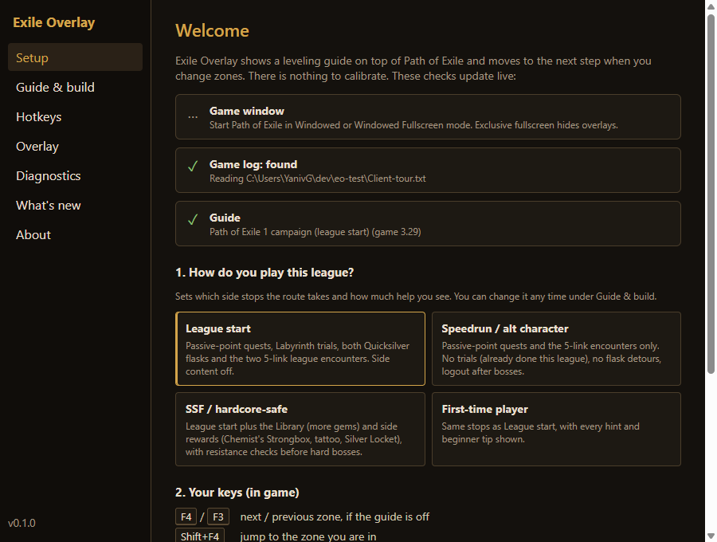
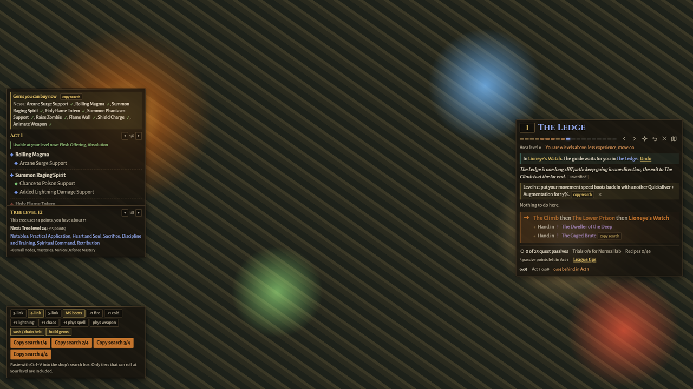
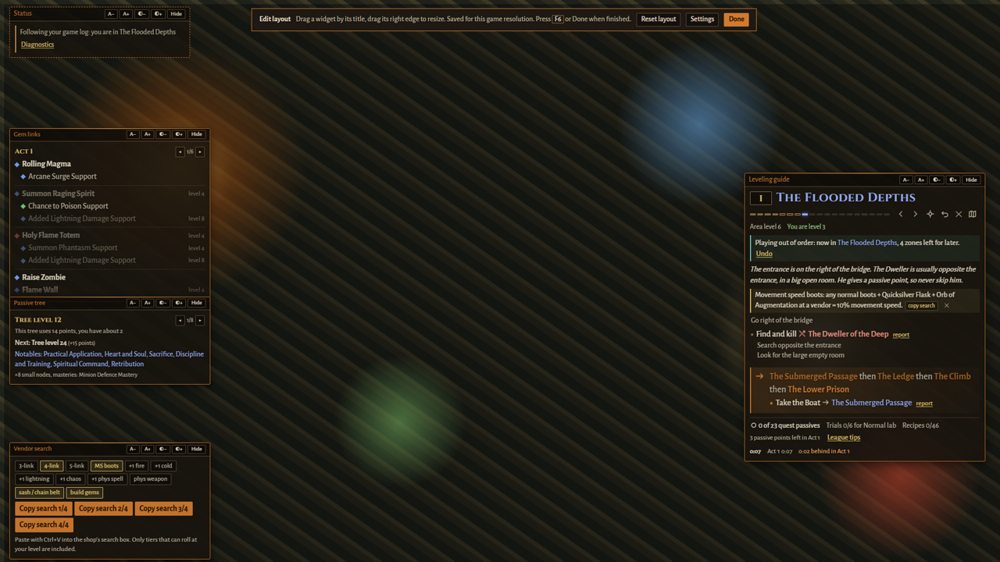

# Exile Overlay

A leveling overlay for Path of Exile 1 that sets up in a minute and stays out of your way. It reads the game's log file to know which zone you're in and moves the guide on when you change zones. It never touches game memory or files and never sends inputs.

**[Download the latest release](https://github.com/YanivGabay/exile-overlay/releases/latest)** · Windows · free and open source (MIT) · beta for the 3.30 league



## Quick start

1. **Install.** Download `ExileOverlay-Setup-<version>.exe` from the [latest release](https://github.com/YanivGabay/exile-overlay/releases/latest) and run it. The beta isn't code-signed: if Windows says "Windows protected your PC", click **More info** → **Run anyway**. ([Install notes](docs/install.md))
2. **Set up.** The Setup window opens by itself:
   - Choose how you play: league start, speedrun, SSF/hardcore-safe or first time.
   - Optionally, paste your Path of Building code or link.
   - Click **Done**.

   
3. **Play.** Start Path of Exile in **Windowed** or **Windowed Fullscreen** and log in. The guide appears on the right once you enter a zone. The game log is found automatically. If the game's in an unusual folder, Setup offers **Choose Client.txt…**.

| Key | Does |
|---|---|
| F4 / F3 | next / previous zone, if the guide is off |
| Shift+F4 | jump to the zone you are in |
| F6 | move and resize panels (press again to save) |
| F7 | hide or show the overlay |

All keys can be changed under Settings → Hotkeys. Settings opens from the tray icon.

## What you get

- Each zone shows what to do and where to go next, and the guide moves on by itself as you change zones.
- Your build's gems and links for your level, what to take from quests and what to buy, and which passive tree fits now.
- In town, vendor search text to copy in one click: links, movement speed boots, +1 wands, weapon recipe bases.
- Reminders that matter: boots, weapon upgrades, level checks before big bosses, danger zones, Kitava's resistance penalty.
- A campaign timer with act splits and live pace against your best run, plus a run summary to share at the end.
- League tips for the current league, marked "unconfirmed" until they're checked in game.
- Movable, resizable panels that fade while you play; layouts are saved per game resolution.

| In town with a build | Layout edit mode (F6) |
|---|---|
|  |  |

## What it reads and sends

- **Reads** the game's log file (`Client.txt`) for your zone, character name, class and level. Nothing else on your PC.
- **Downloads** guide updates from [exile-overlay-guides](https://github.com/YanivGabay/exile-overlay-guides), app updates from this repo's releases, and the build links you paste.
- **Never** reads or changes game memory or files, sends keys or clicks to the game, or uploads anything about you.
- Draws in its own transparent window on top of the game; it never moves or resizes the game window.

## FAQ and known issues

**Windows says "Windows protected your PC" when I run the installer.**
The beta isn't code-signed yet, so SmartScreen warns about it. Click **More info** → **Run anyway**. Your browser may also call the file uncommon: choose **Keep**. The source is public and every release is built by CI from a tagged commit.

**The overlay doesn't show up over the game.**
- Set the game to **Windowed Fullscreen** (or Windowed) under Options → Graphics. In **exclusive Fullscreen**, Windows hides every overlay; this is a Windows limit, not something we can fix.
- Log in to a character and enter a zone: the overlay hides itself on the login and character screens.
- Check it isn't hidden: press **F7**, or use the tray icon (it may sit under the ^ arrow near the clock).
- If the game runs as administrator, run Exile Overlay as administrator too.

**F6 (or another key) opens emojis or does nothing.**
Many keyboards send special functions from the F-key row unless you hold **Fn** (some have an Fn lock, often Fn+Esc). Hold Fn, or choose other keys under Settings → **Hotkeys**. The tray menu also has **Edit layout** and **Hide / show overlay**, no key needed.

**How do I get a panel out of the way quickly?**
Click the small **–** tab on the top edge of Gem links, Passive tree or Vendor search to fold it to a tab; click the tab to open it again. To hide a panel completely, use **Hide** in edit mode (F6) or untick it under Settings → Overlay.

**It says it can't find the game log (Client.txt).**
It's found automatically from the running game, so start the game first. If it still isn't found, Settings → Diagnostics → **Choose Client.txt…** and pick `logs\Client.txt` in the game folder:
- Steam: `…\steamapps\common\Path of Exile\logs\Client.txt`
- Standalone: `C:\Program Files (x86)\Grinding Gear Games\Path of Exile\logs\Client.txt`

**The guide is on the wrong zone.**
Press **Shift+F4** to jump to the zone you're in, or use undo (↶) on the guide. If a step is simply wrong, press F6 and click **report** next to it.

**Is it allowed?**
It only reads the game's log file, the same file other leveling tools read. It never reads game memory, never changes game files and never sends keys or clicks to the game. It isn't endorsed by Grinding Gear Games.

**Known issues in the 0.1 beta**
- The route data is from 3.29 with 3.30 tips added from the patch notes. Zones or bosses that changed in 3.30 may be wrong for the first days; guide fixes download by themselves within 30 minutes.
- League tips marked "unconfirmed" come from the 3.30 reveal and aren't checked in game yet. The 5-link drops in The Slave Pens and the Act 6 Twilight Strand may not exist in 3.30.
- Windows only, Path of Exile 1 only.

Still stuck? Settings → Diagnostics → **Report a problem** copies a report (no account or character names) and opens the [bug form](https://github.com/YanivGabay/exile-overlay/issues/new?template=bug_report.yml). [Install notes](docs/install.md) have more detail.

## Contributing

- **A wrong route step or tip:** press F6 in game and click **report** next to the step; it opens a pre-filled issue in [exile-overlay-guides](https://github.com/YanivGabay/exile-overlay-guides). Route fixes ship to every player within 30 minutes, without an app update.
- **A bug in the app:** Settings → Diagnostics → **Report a problem**, or open the [bug form](https://github.com/YanivGabay/exile-overlay/issues/new?template=bug_report.yml) and paste the Diagnostics report.
- **An idea:** the [feature idea form](https://github.com/YanivGabay/exile-overlay/issues/new?template=feature_idea.yml).
- **Code:** pull requests are welcome. Run `npm test` and `npm run typecheck` first, and keep content your own (no text or images copied from other guides).

## Development

Node 24 (`nvm use`), then:

```sh
npm install
npm test               # vitest, all workspaces
npm run typecheck
cd apps/overlay && npm run dev    # needs Windows to attach to the game
```

`npm run dist` in `apps/overlay` builds the installer (Windows). Releases are built by CI from a `v*` tag: see [docs/maintainers](docs/maintainers/README.md).

### How it fits together

```
apps/overlay/src/
  main/                    Electron main process
    index.ts               startup: creates the services and windows and wires them together
    commands.ts            every command a window can send to main (IPC)
    config.ts              URLs and test-hook environment variables
    game/                  finds and tails Client.txt
    guide/                 loads guide bundles, compiles the route, tracks progress per character
    state/                 the single AppState, saved to settings.json and broadcast to every window
    windows/               overlay window over the game, settings window, tray, hotkeys
    support/               app log, crash handling, updates
    testing/               offscreen capture and scripted tours (only with test env vars)
  preload/                 the small API the windows get (window.api)
  renderer/
    overlay/               the in-game overlay
      layout/              widget frame, click-through regions, fading, stacking
      guide/  build/  search/  status/   one folder per widget
    settings/              the settings window: tabs/ and components/
    common/                api hooks, error boundary, theme
  shared/                  types and pure logic used by both sides (timer, changelog, reports)
packages/
  log-watcher/             parses and tails Client.txt; finds it from the running game
  route-engine/            route language, guide compiler, progress tracking, PoB builds, passive trees
guides-snapshot/poe1.json  the guide bundle shipped inside the app (fallback when offline)
scripts/                   log replay, accuracy check, offscreen UI tours for Windows
```

Data flows one way: log lines → `GameLog` → `GuideService` → `AppState` → every window. Windows never change state directly; they send a command (`shared/types.ts` lists them) and main updates the state.

Docs: [install notes](docs/install.md) · [maintainer checklists](docs/maintainers/README.md) · [working notes and research](docs/notes/README.md).

## Thanks

The route language, the first route and the game data come from [exile-leveling](https://github.com/HeartofPhos/exile-leveling) by HeartofPhos (MIT). Tips are written in our own words from public guides, credited in the app under About. Third-party code and data: [THIRD_PARTY_NOTICES.md](THIRD_PARTY_NOTICES.md).

This product isn't affiliated with or endorsed by Grinding Gear Games in any way.

License: [MIT](LICENSE).
