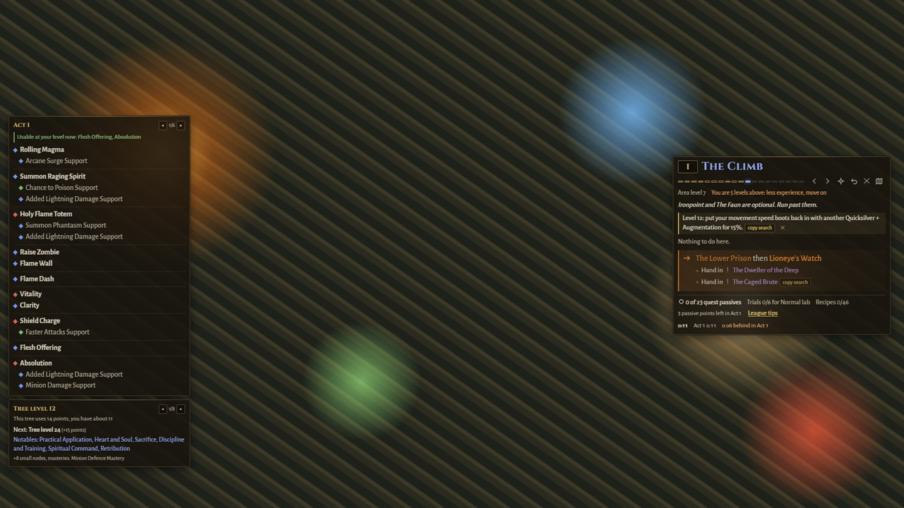

# Exile Overlay 0.1.1: first beta, for Path of Exile 3.30

A leveling overlay for Path of Exile 1 that sets up in a minute and stays out of your way. It reads the game's log file to know where you are, and moves the guide on when you change zones. It never touches the game's memory or files and never sends inputs.

## What it does

- **A guide that follows you.** Each zone shows what to do there and where to go next. It moves on when you change zones and catches up if you skip ahead. Undo and "I'm here" fix the rare wrong guess.
- **Pick how you play.** League start, speedrun/alt character, SSF/hardcore-safe, or first time. Each sets which side stops the route takes and how much help you see.
- **Your build, in the guide.** Paste a Path of Building code or a pobb.in / poe.ninja / Maxroll link. You get which gems to take from quests and which to buy, your links for your current level, and which passive tree fits now.
- **Vendor search, one click.** Search text for 3- and 4-links, movement speed boots, +1 wands and weapon recipe bases, sized to the game's search box.
- **Campaign timer.** Act splits, deaths and levels per hour, with live pace against your best run ("1:12 ahead in Act 3"). At the end, a run summary you can paste into Discord or Reddit.
- **Reminders that matter.** Movement speed boots, weapon upgrades and vendor recipes, level checks before big bosses, freeze and bleed danger zones, and Kitava's resistance penalty, each shown only when it applies.
- **Your layout.** Move, resize and fade every panel (F6). Layouts are saved per game resolution. The guide fades while you play and gets out of the way when your cursor is over it.

## Install

Download `ExileOverlay-Setup-0.1.1.exe` below and run it. The beta isn't code-signed yet: if Windows says "Windows protected your PC", click **More info** → **Run anyway**. [Full install notes](../install.md).

Start Path of Exile in **Windowed** or **Windowed Fullscreen** mode.

## Known limits in this beta

- Windows only, Path of Exile 1 only.
- The route was written for 3.29 and checked against the 3.30 patch notes. Covens tips that the patch notes don't confirm yet are marked "unconfirmed", and the 5-link drops in The Slave Pens and the Act 6 Twilight Strand may be gone in 3.30. Guide fixes in the first days download by themselves, with no reinstall.
- The installer isn't signed, so SmartScreen warns once (see above).
- Exclusive fullscreen hides overlays (a Windows limit).

## If something goes wrong

Settings → Diagnostics → **Copy report**, then paste it into a [GitHub issue](https://github.com/YanivGabay/exile-overlay/issues). The report contains no account or character names. Wrong route step? Press F6 and click **report** next to the step: it opens a pre-filled issue.

## Thanks

The route language, the first route and the game data come from [exile-leveling](https://github.com/HeartofPhos/exile-leveling) by HeartofPhos (MIT). Tips are written in our own words from public guides, credited in the app under About. This product isn't affiliated with or endorsed by Grinding Gear Games.
